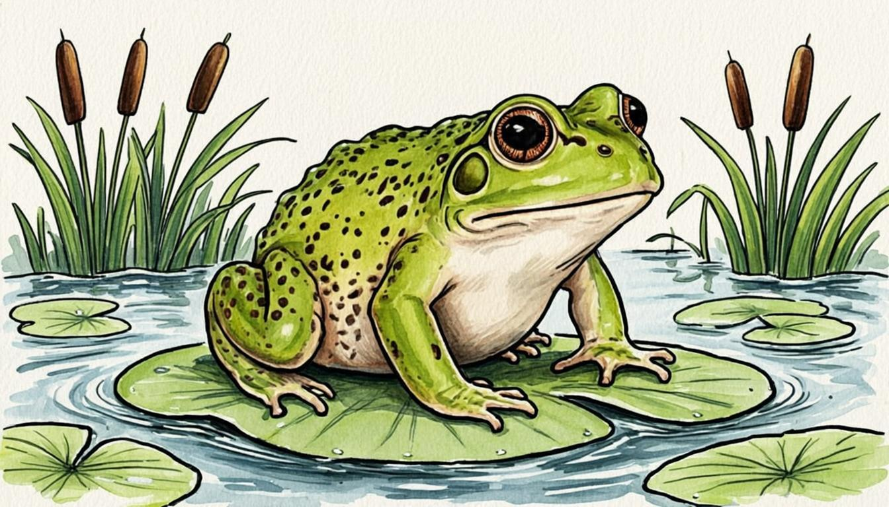

# toadHEALTH

<p align="center">
  
</p>

<p align="center">
  <a href="https://github.com/dukeoftoad/toadHEALTH/actions/workflows/flutter-ci.yml"></a>
  <a href="https://github.com/dukeoftoad/toadHEALTH/actions/workflows/release-apk.yml"></a>
  <a href="https://github.com/dukeoftoad/toadHEALTH/actions/workflows/gh-pages.yml"></a>
</p>

**toadHEALTH** is a hand-drawn, **local-first, end-to-end encrypted** health
companion built with Flutter - and the toad is not just a mascot, it is the
body of the app. The toad walks your dashboard, runs when you push yourself,
physically hops between navigation tabs, floats on its lily pad as you drink
water, and sleeps when you should be sleeping.

Every stroke in the UI is drawn at runtime by a wobbly-ink "sketchy" engine
built on `CustomPainter` - no static icon fonts, no stock vectors.

## Real encrypted backend (v1.1)

All simulated data is gone. The app now runs on a real, layered on-device
backend - see [ARCHITECTURE.md](ARCHITECTURE.md):

- **Real data** - steps come from the hardware step counter (AOSP
  `TYPE_STEP_COUNTER`, via our own ~150-line Kotlin channel - not Google Fit,
  not Health Connect, no Play Services). Water, sleep and goals are honest
  manual logs. Weekly charts, streaks, averages and the hourly rhythm are all
  computed from stored records.
- **Strong encryption** - every record lives in a single AES-256-GCM envelope.
  The master key is sealed by the **Android hardware Keystore** (non-exportable).
  Optional app password: PBKDF2-HMAC-SHA256, 250k iterations, per-credential salt.
- **Password restore** - a 120-bit recovery code (shown once at password
  creation) unwraps the master key and re-keys the password credential. No
  account, no email, no server.
- **Portable encrypted backups** - `TOAD1:` backup codes are pure ciphertext
  under your own passphrase. Store them anywhere.
- **Zero network** - the Android manifest declares **no INTERNET permission**;
  `allowBackup="false"` keeps the vault out of Google Drive backups.
  See [PRIVACY.md](PRIVACY.md) for the full de-Googling checklist and
  [SECURITY.md](SECURITY.md) for the threat model.

## The toad is the body of the app

- **Hand-drawn everything** - a deterministic ink-wobble engine powers every
  line, circle, blob, chart and icon.
- **The toad mascot** - five live-animated poses: idle, walk, run, sleep, cheer.
- **Toad navigation** - the bottom nav is a pond the toad hops across.
- **Flowing transitions** - screens drift in like lily pads.
- **Handwritten typography** - Caveat and Gochi Hand bundled locally.

## Screens

Splash (toad hops in) -> Lock screen (if app password is set) -> Home pond ->
Motion / Water / Sleep / You (security, backups, data).

## Getting started

Requires Flutter 3.22+ (any channel).

```bash
flutter pub get
flutter run
```

The Android platform folder is fully checked in, so `flutter build apk
--release` works out of the box. For iOS run:

```bash
flutter create . --platforms ios
flutter run
```

### Build an APK

```bash
flutter build apk --release
# build/app/outputs/flutter-apk/app-release.apk
```

## Workflows

| Workflow | Trigger | What it does |
| --- | --- | --- |
| `flutter-ci.yml` | push / pull request | `flutter analyze` + debug APK build, uploads APK artifact |
| `release-apk.yml` | tag `v*` / manual | release APK build, attached to a GitHub Release |
| `gh-pages.yml` | push to main / manual | Flutter web (HTML renderer) deployed to GitHub Pages |

Live web demo: <https://dukeoftoad.github.io/toadHEALTH/>

## Project layout

```
lib/
  main.dart               entry point; boots the encrypted vault
  app.dart                MaterialApp + flowing page transitions
  splash.dart             boot screen; routes to lock screen or home
  core/                   crypto engine, platform channels, storage adapters
  data/                   models, encrypted repository, vault/key service
  state/                  AppController (source of truth), boot
  screens/                lock screen, manual log sheets
  ...                     sketchy engine, toad painter, icons, charts,
                          widgets, theme, nav shell, five screens
```

## License

MIT - see [LICENSE](LICENSE).
